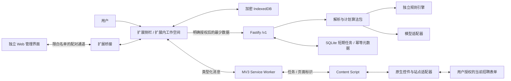

# FormPilot V1.0 技术方案

版本：0.1 · 日期：2026-11-16 · 状态：2026-11-16 已获产品方确认，M0 工程验证通过，M1 核心实现与工程验证通过，待授权真实简历验收；用户已授权先推进 M2，扫描实现见 [M2 决策](adr/0003-m2-form-scanning.md)，M1 见 [M1 实现决策](adr/0002-m1-local-vault.md)。

需求基线：[PRD V1.0](PRD.md)。本文包含设计提案；接口细节在 M3 冻结，实施前须通过 PRD §12.1 的方案确认。

## 1. 范围与架构决策

V1.0 以“一份简历、一个已适配且获授权的真实招聘网站、一个可核验的填写闭环”为验收单位。先实现本地工作空间，不引入账户注册、跨设备同步、岗位推荐、JD 分析、简历定制或开放题生成。

核心约束：只有已确认事实或用户本次明确提供的答案可以形成执行值；AI 提议不能直接驱动 DOM；用户批准绑定具体计划版本和内容；任何失效条件都阻断执行；申请提交始终由用户操作。

方案制定时仓库包含 React 展示页、JavaScript MV3 扩展及一份内嵌扩展源码用于下载，没有独立后端、结构化事实资产库或统一版本协议。旧扩展的直接模型调用、PROFILE.md 资料和全站注入不作为新产品的基础模型。M0 从新的工作区包开始建设，旧文件经保留与清理清单处理；不会把旧扩展改名视为 MVP 已完成。

## 2. 技术选型及理由

| 模块 | 拟采用技术 | 理由与取舍 |
|---|---|---|
| 工程 | pnpm workspace + TypeScript strict | 一个语言贯通 UI、规则、协议和服务；使用工作区即可，暂不引入 Turborepo、微服务编排 |
| 运行时 | Node.js LTS | M0 锁定当时受支持的具体 LTS、包管理器和依赖版本，提交锁文件；不沿用旧包版本清单 |
| 前端 | React + Vite + React Router + CSS Modules | 页面管理、事实编辑和计划预览需求清晰，无 SSR/SEO 强需求；避免初期引入完整全栈框架 |
| 扩展 | Chromium MV3 + TypeScript + Vite 多入口构建 | 显式构建 popup、side panel、options、service worker、content script；首版不依赖大型扩展框架 |
| 后端 | Fastify + TypeBox JSON Schema + Ajv | HTTP 校验、响应约束和接口测试统一；共享 JSON Schema，减少多套定义漂移 |
| 算法 | 独立 TypeScript 包，部署在 API 进程内 | 抽取、决策与规则可独立测试；接口解耦不意味着必须拆成 Python 服务或独立部署 |
| 模型 | Provider 接口 + 一个首发供应商适配器 | 统一超时、结构化结果、拒绝与用量处理；模型和 endpoint 由服务端配置，不硬编码型号 |
| PDF | 本地 PDF.js worker | 按页提取文本与位置，生成可追溯块；不默认上传原 PDF，不将扫描件解析失败伪装成功 |
| 本地存储 | 扩展 origin 的 IndexedDB + Dexie | 事实、证据、文档、任务均以本地为权威；支持事务和迁移 |
| 加密 | Web Crypto AES-GCM + 用户口令派生密钥 | 个人数据持久化前加密；不把解密密钥和密文永久放在一起 |
| 服务端存储 | SQLite + 明确 SQL 迁移 | 单实例只保存最少的计划/幂等元数据及用户授权的短期任务数据；后续有实际需求再迁移 PostgreSQL |
| 日志 | Fastify/Pino，字段白名单 | 记录请求 ID、状态、耗时和计数，不记录简历正文、字段值、答案或密钥 |
| 测试 | Vitest + Fastify inject + Playwright Chromium | 分别覆盖纯规则、接口和加载真实扩展的浏览器闭环 |
| 质量 | ESLint + Prettier + tsc + CI | 统一代码约束、构建检查及可复现验证 |

首版不引入 Redis、消息队列、向量数据库、对象存储、Kubernetes。先用受限请求与持久化检查点完成闭环，再用实际瓶颈决定扩展。

## 3. 系统与数据流



扩展内 options 工作空间是个人资料的首版主入口，与侧栏使用同一扩展 origin。`apps/web` 是独立管理界面和后续产品入口，不能假设它与扩展共享 IndexedDB。Web 通过用户配对后的扩展桥接调用受限资料操作；未连接时只展示连接状态，不在网站 localStorage 建立第二套资料库。

桥接只允许精确列出的开发/产品 origin，验证 sender origin、消息 schema、配对会话和方法白名单；不开放任意脚本、任意网络请求或执行填写入口。M0 先验证无敏感信息的 ping/health，敏感资料桥接在 M1 加入授权与加密会话设计。

关键流程：

1. 本地选择 PDF/TXT → 大小/类型检查 → PDF worker 文本提取 → 按页分块 → 用户确认模型处理范围。
2. API 抽取候选 → JSON Schema 校验 → 引用/业务规则校验 → 用户逐项确认 → 本地保存版本化事实。
3. 用户启动扫描 → content script 生成快照 → UI 选择必要事实 → 明确授权模型处理 → 请求计划。
4. 算法生成五类决策 → 规则再次约束 → 追问/冲突确认 → 形成新版本 → 用户预览并批准。
5. 扩展验证批准、版本、页面和字段原值 → 逐字段写入 → 延迟回读和校验 → 本地保存报告 → API 验证报告一致性。
6. 失败项由用户重试或人工处理；撤销逐字段比较当前值与本次写入后值，满足条件才恢复。

## 4. 模块边界与依赖

- `contracts`：所有外部输入、输出和扩展消息的 schema、枚举、错误码；无 DOM/数据库依赖。
- `domain`：事实版本、任务状态、批准失效、日期精度、冲突规则和经历绑定；纯函数，不能调用模型或浏览器。
- `ai`：parse、match、questions、plan、resolve、verify 用例；依赖抽象模型 Provider、仓储接口与 domain。
- `browser-engine`：扫描、定位、适配、写入、回读、撤销；仅扩展 content runtime 使用。
- `local-store`：加密、IndexedDB 事务、版本迁移与删除；不依赖页面 DOM。
- `api`：传输校验、认证/工作空间隔离、请求幂等、模型调用与审计元数据。
- `extension`、`web`：展示与用户操作编排，不在 UI 中重复实现决策规则。

站点适配器实现统一契约 `supports / scan / locate / write / read / validate`。原生适配器为默认；站点差异封装在适配器中，不污染核心执行器。V1.0 不实现动态新增经历、Shadow DOM 或级联控件，遇到不支持项明确返回 manual。

## 5. 核心数据模型（草案）

所有记录含 `schema_version`、创建时间，ID 采用随机 UUID（展示前缀只用于可读性）；所有引用须验证存在且归属同一工作空间/任务。

| 模型 | 主要字段 | 约束 |
|---|---|---|
| Workspace | workspace_id、created_at、vault_version | 首版支持本地工作空间；workspace_id 不是认证凭据 |
| ResumeDocument | document_id、document_revision、name、mime、content_hash、created_at | 原文件仅在本地加密保存；新文件产生新文档/版本 |
| SourceBlock | document_id、document_revision、block_id、page、text、offsets | 页码从 1 开始，TXT 允许 page=null；引用不可跨文档版本 |
| Evidence | evidence_id、document_id、document_revision、page、block_id、quote、start/end | quote 必须可定位到对应原文块；不接受模型捏造证据 |
| ExperienceEntity | entity_id、category、fact_ids | education/work/internship/project 等分类明确；字段不得跨实体拼接 |
| Fact | PRD 基础字段 + fact_revision、profile_revision、value_type、precision、supersedes_fact_id | 同一 fact_id 的历史 revision 不覆盖；来源和确认状态独立 |
| ProfileRevision | profile_revision、fact_refs、entity_refs、created_at | 指向明确 fact revision；修订递增且不可变 |
| FactConflict | conflict_id、path、entity_id、candidate_fact_refs、resolution | 不以“最新文档”为由静默替换旧事实 |
| FormSnapshot | form_snapshot_id、page_instance_id、tab/frame、origin、route、adapter_version、dom_fingerprint、fields | 不含无关网页正文和带 token 的完整 URL；字段 ID 仅在本快照有效 |
| FormField | PRD 基础字段 + group_id、semantic_path、entity_hint、locator_ref | 类型化 current_value；约束包括 min/max、pattern、maxLength、step、accept 等 |
| TaskAnswer | answer_id、question_id、field_ids、value、scope、source、revision | scope 默认 task；升级 profile 必须用户单独确认 |
| Question | question_id、field_ids、semantic_key、prompt、answer_type、options、required、current_answer、source、scope | 相同业务含义可聚合；不同经历实体的问题不能错误合并 |
| FieldDecision | field_id、decision、current_value、target_value、fact_refs、answer_refs、evidence_ids、entity_id、reason_code | fill 必须具有已确认来源；review 不可直接执行 |
| FillPlan | plan_id、plan_revision、task_id、profile_revision、form_snapshot_id、dom_fingerprint、decisions、questions、entity_bindings、status、degraded、digest | 新版本不可原地修改；字段修改/取消也产生新版本 |
| Approval | approval_id、plan_id/revision、plan_digest、snapshot_id、profile_revision、approved_field_ids、approved_at | 只批准显式选中字段及其值；任何相关修订都失效 |
| Task | task_id、workspace_id、state、state_revision、active_plan_ref、resume_checkpoint | 状态更新采用比较并交换，阻止并发覆盖 |
| ExecutionReport | execution_id、task/plan/snapshot refs、approval_ref、field_results、started_at、ended_at | 每字段包含 before/target/actual、校验结果、错误码、时间 |
| UndoEntry | execution_id、field_id、before、written_value、locator_ref、page_instance_id、write_epoch | 仅撤销本任务成功写入且未被后续编辑的字段 |

`confirmation` 为 pending/confirmed/rejected；`source_type` 为 resume/user/inference 等，模型推断不会因置信度高而自动 confirmed。用户修改事实形成新 revision，原始证据保留，新增 user 来源；不能把修改后的值假称来自简历原文。

日期使用 `{ value: "2025-06", precision: "month" }` 等显式类型，支持 year/month/day/present；不靠 Date 对象隐式补齐。date 控件遇到 month 精度要求 ask/review。手机号、证书编号保持字符串。radio 单选值、checkbox 布尔或选项数组、select 使用 value/label 对，选项不存在不得强行写入。

## 6. API 与协议设计

### 6.1 通用契约

命名采用 snake_case，API 路径 `/v1`。请求使用 JSON，业务请求包含 `client_request_id`，传输头包含 `X-Request-Id`、`Idempotency-Key` 和工作空间会话凭据。工作空间身份从认证会话取得，不能相信任意传入的 workspace_id。成功响应 `{ request_id, data, error: null }`；错误响应 `{ request_id, data: null, error: { code, message, retryable, details } }`。details 只允许白名单字段，不回显简历或敏感原值。

| HTTP | code | 语义 |
|---|---|---|
| 400 | INVALID_REQUEST | schema 不合法 |
| 401/403 | UNAUTHORIZED / CONSENT_REQUIRED / SCOPE_DENIED | 会话、授权或任务作用域不满足 |
| 404 | REFERENCE_NOT_FOUND | fact/field/plan/evidence 等引用不存在或不可访问 |
| 409 | REVISION_CONFLICT / STALE_PLAN / IDEMPOTENCY_CONFLICT | 修订过期、批准过期、相同幂等键不同请求 |
| 422 | UNSUPPORTED_DOCUMENT / EVIDENCE_INVALID / RULE_VIOLATION | 文档或业务约束不满足 |
| 413/429 | PAYLOAD_TOO_LARGE / RATE_LIMITED | 请求大小与调用频率超限 |
| 502/504 | MODEL_INVALID_OUTPUT / MODEL_TIMEOUT | 模型异常，安全降级可返回成功但 degraded=true |
| 500 | INTERNAL_ERROR | 脱敏内部错误 |

Schema 禁止意外属性、约束长度与数量，采用服务端内置 schema，绝不编译用户提供的 schema。传输校验不进行会影响语义的隐式类型转换。响应也受 schema 约束，模型 JSON 合法仍必须经过领域规则。

幂等存储键为 `(workspace_session, operation, idempotency_key)`，绑定规范化请求摘要和结果；同键同体返回原响应，不重复消耗模型调用，同键不同体返回 409。幂等记录建议保留 24 小时（可配置）；涉及个人信息的请求结果加密并设置明确过期时间。CAS 检查与新版本保存位于同一事务。

### 6.2 四个核心接口

| 接口 | 请求 | 响应与规则 |
|---|---|---|
| POST /v1/profile/parse | document_id、document_revision、source_blocks、模型处理授权引用 | fact_candidates、evidences、anomalies、confirmation；输出均待确认，原文引用二次校验 |
| POST /v1/fill/plan | task_id、profile_revision、form_snapshot、confirmed_facts、task_answers、授权引用 | PRD 规定的 plan_id/revision、snapshot/fingerprint、field_decisions、questions、entity_bindings、status、degraded；所有 field_id 必须属于快照 |
| POST /v1/fill/resolve | plan_id、expected_plan_revision、answers、client_request_id；扩展 resolution 操作支持保留/替换/取消/编辑 | 新计划版本及剩余问题；旧批准立即失效；未知问题或越权答案拒绝 |
| POST /v1/fill/verify | task_id、plan_id/revision、snapshot_id、user_approval、execution_report | verified_fields、failed_fields、remaining_manual_fields、status、application_submitted=false；引用与批准范围不符拒绝 |

verify 只能检查客户端回读报告与计划的一致性，服务端不能宣称独立观察了第三方 DOM 或云端保存。最终执行事实由浏览器回读及站点适配器提供；网页本地值 verified 不代表企业服务端保存成功。

### 6.3 配套接口与本地命令

M0 实现 `/health` 和 `/v1/system/capabilities` 以验证真实通信。阶段实现时增加最少的本地配对会话、计划恢复/授权操作；不为本地资料引入全量云端 CRUD。确认事实、编辑资料、加密导出/导入、删除资料均为扩展工作空间内的本地命令。M3 为计划批准定义受限动作以绑定不可变摘要，不能仅凭任意客户端 `approved: true` 视为合法。

SQLite 中的短期计划只能由当前工作空间会话访问。开发默认监听回环地址，Web 精确 origin 白名单；生产 HTTPS、会话认证和额度限制不能仅由 CORS 替代。无在线会话时仍允许本地资料管理；缺少模型配置明确显示服务不可用，不用 Mock 返回成功。

## 7. 扩展架构与执行一致性

### 7.1 入口和权限

- Popup：连接状态、当前任务入口、用户主动启动扫描。
- Side panel：字段预览、证据、追问、批准、执行进度、报告与撤销。
- Options：本地工作空间、导入简历、资料确认和隐私管理。
- Service worker：消息鉴权、任务编排、API 通信，不持有唯一内存状态。
- Content script：扫描、受限 DOM 操作、回读，不访问模型密钥或整份资料库。

最小权限 `activeTab`、`scripting`、`storage`、`sidePanel`，仅声明所选 API origin；用户动作后注入。单站持久权限或跨源 iframe 权限按实际适配需要单独申请。默认不启用 `<all_urls>`，不在所有 frame 注入。受限页面、未授权 iframe、密码、验证码、支付和提交控件不参与自动写入。

所有消息携带 protocol_version、request_id、task_id 和适用的 page_instance/plan revision。验证 sender、tab、frame 和 payload；网页 DOM 文字不能构造内部执行命令。Web 桥接不能转发执行消息。

### 7.2 快照与失效

结构指纹包含字段身份、类型、选项、约束、分组和适配器版本，不包含会被执行改变的值；字段原值单独保存在快照中。这样自身写入不会让结构指纹立即过期。

每次导航/文档替换创建新的 page_instance_id；路由切换和 MutationObserver 检测相关变化并去抖重扫。装饰动画等无关变化不导致计划失效。执行前及每字段前检查页面身份、结构指纹、资料 revision、批准摘要与原值；相关结构变化暂停整个旧计划，单个字段用户改动则保护该字段并提示重审。

使用本地唯一执行锁与单调 execution epoch，阻止同一任务双击执行、撤销与写入竞争。记录字段检查点后再启动下一项；worker 重启后先回读，不能盲目重放。页面跳转、权限消失、执行状态不明都要求重新扫描/审核。

### 7.3 控件与核验

原生输入使用正确原型 setter，并派发 input/change；radio/checkbox 依据明确的选项映射操作。禁止通过点击父表单按钮完成所谓填写。file 首版提供用户选文件的人工入口，识别 accept/大小限制，不承诺绕过浏览器文件访问限制；原生 file 控件支持识别与报告 manual，不计入可自动执行控件承诺。

每字段写后等待适配器定义的稳定窗口，多次回读 value/checked/selected 和浏览器约束校验结果，检查 aria-invalid 与相关错误消息。React 写后清空判定 VALUE_NOT_PERSISTED；未改变的旧值不能报告成功。默认稳定窗口提案为 500ms，核验上限 2s，实际按目标网站测量调整。只能证明观测窗口内页面值稳定，网站之后异步清空仍可能发生；最终报告前再回读一次。

定位失败、控件不支持、值未持久化、网站校验失败、页面变化、用户修改分别使用 LOCATOR_NOT_FOUND、CONTROL_UNSUPPORTED、VALUE_NOT_PERSISTED、SITE_VALIDATION_FAILED、PAGE_CHANGED、USER_CHANGED。依赖字段失败只阻断其依赖项，独立字段继续；结构变化例外，暂停全部过期计划。

### 7.4 安全撤销与重试

撤销比较页面身份、定位信息、当前实际值和 written_value，并检查自写入后的用户编辑标记；只有匹配且仍未被用户修改才恢复 before。即使用户修改后又改回同一字符串，也应根据编辑标记保护该字段。恢复后同样回读；不能撤销第三方已保存的服务器数据，也不撤销文件上传。

单字段重试重扫当前字段、验证来源和批准、比较当前值；产生新执行记录。页面/值/计划变化需要新版本及再次批准。任务恢复只恢复到可审查检查点，不自动恢复写入。

## 8. AI 算法与规则设计

简历解析：本地分块 → Provider 结构化抽取 → JSON Schema → 证据 substring/offset 核验 → 事实标准化 → 日期与实体规则 → 候选事实待确认。重复文档以内容 hash 提示，不静默合并多份简历的矛盾。

字段计划：清理并最小化字段上下文 → 规则候选召回 → AI 语义匹配与实体建议 → 确定性规则校验 → 五类决策 → 缺项去重问题 → 计划版本。模型只引用已提供的事实与字段 ID，服务端校验引用集合、归属、确认状态与证据链。

规则注册表分别实现语义 path 区分、精度、选项、事实冲突、网页值冲突、实体绑定、时间关系和禁止写入，不把业务规则仅写进 Prompt。现居城市与意向城市使用不同语义 path；不能按关键词包含关系判定一致。

实体绑定基于表单 section/group 与 profile entity，单组只绑定一个经历实体；多候选无明确顺序或证据则 review。V1.0 可以识别多段经历并防止交叉匹配，但不承诺自动扩增多段控件。项目结束早于开始属于异常；跨经历时间交叠本身不构成错误。

决策顺序：禁止/无关字段 skip → 不支持控件 manual → 事实或网页冲突 review → 缺项 ask（可选空项可 skip）→ 可靠同义且约束可满足 fill。置信度只用于解释和排序，不能绕过事实确认、批准和冲突规则。

网页文本与简历文本放在数据边界中，不作为系统指令；Provider 不提供浏览器工具、代码执行或提交能力。输出意图、任意 URL 或不存在引用全部拒绝。简历中包含“忽略规则”等指令不得影响系统行为。

超时提案：解析总预算 60s，计划生成 30s，resolve 30s；每个 provider attempt 在总预算内使用 AbortSignal，最多一次可重试瞬时错误。扩展不使用一个长等待 service-worker 请求承载整个流程，开始任务后持久化句柄，通过短请求读取进度/结果。M1 确认任务启动/查询契约并测量真实模型延迟。

无效 schema、拒绝响应、超时或证据异常返回安全降级：`degraded=true`，匹配中保留可确定的 skip/manual 并将不确定项设 ask/review，不生成可直接执行的推断；解析失败不生成已确认事实。展示明确原因，不把降级当作完整成功。

## 9. 状态、版本与批准

| 事件 | 状态变化 | 守卫 |
|---|---|---|
| 初始化 | → DRAFT | 创建任务及页面绑定 |
| 生成计划 | DRAFT/WAITING_USER/REVIEW → PLANNED | 保存不可变计划与资料 revision |
| 请求审核/追问 | PLANNED → WAITING_USER | 所有计划均须经过用户审核，包括无缺项计划 |
| 回答/编辑/保留/替换 | WAITING_USER → PLANNED → WAITING_USER | CAS 通过，生成新 revision，旧批准作废 |
| 用户批准 | WAITING_USER → READY | 所有阻塞冲突已解决；仅批准具体可写字段及值 |
| 开始执行 | READY → WRITING | 批准有效、页面/资料/字段原值一致、获得执行锁 |
| 结束/中断 | WRITING → REVIEW | 逐字段结果与未完成项已持久化 |
| 资料/页面变化 | READY/WAITING_USER/REVIEW → DRAFT | 批准失效，需重扫或重算；WRITING 先暂停并保存报告 |

manual 必填项可允许其他独立字段先执行，但报告始终列为未完成，不能显示全部完成。状态保持 REVIEW，不新增“申请已提交”状态。verified 只表示字段回读通过，`application_submitted` 固定 false。

## 10. 本地优先、加密与数据生命周期

资料唯一权威位于扩展加密仓库。随机 data key 加密记录，用户口令经 PBKDF2（随机 salt、参数版本化、按设备校准）派生 wrapping key；每次加密使用独立随机 IV，关联数据绑定记录 ID/版本。data key 仅解锁期间持有，锁定清理内存/会话；worker 重启后若无有效解锁会话提示重解锁。不得把口令或明文解密密钥写入持久化配置。

解锁不是本地恶意软件防护；首版须解释口令丢失后的恢复边界。M1 提供加密备份导出/导入、修改口令与完整删除。删除同时清理原文件、块、证据、事实、计划、报告和缓存，并使相关批准失效。

模型调用前告知供应商、用途和将发送的具体数据类型，授权关联请求范围；扫描页面不等于授权上传整份简历。表单只上传标签、必要分组、选项、约束和相关值。文件内容、无关网站正文、cookie、验证码、支付和密码均不上传。

服务端不持久化原简历，模型密钥仅在服务端环境变量/部署密钥系统。短期计划与幂等响应中的个人值使用服务端独立数据密钥加密；默认 24h TTL（提案），提供主动清理，SQLite 备份/WAL 处理纳入删除方案。无用户授权不启用文件云存储与资料同步。

日志默认只记 event、request_id、任务匿名标识、错误码、计数、耗时；禁止记录请求/响应原体和模型原始输出。供应商数据保留策略在确定供应商时披露，不能把本地优先宣传成“资料从不离开设备”。

## 11. 目标目录结构

以下为分阶段目标结构；M0 已实施的实际范围与取舍见 [ADR 0001](adr/0001-m0-workspace.md)，后续业务模块按阶段引入。

```text
FormPilot/
  apps/
    web/                     # 独立 React 管理入口
    extension/
      src/popup/
      src/sidepanel/
      src/options/
      src/background/
      src/content/
      src/bridge/
      manifest.ts
    api/
      src/routes/v1/
      src/modules/
      src/plugins/
      src/repositories/
      migrations/
  packages/
    contracts/               # schema、错误码、消息与 API 协议
    domain/                  # 事实、版本、规则、状态机
    ai/                      # 用例、Provider 和结构化校验
    browser-engine/          # scanner、locator、executor、verifier、undo
      src/adapters/native/
      src/adapters/sites/
    local-store/             # 加密、IndexedDB 与迁移
    ui/                      # 确有复用需求的表单与证据展示组件
    config/                  # TS、lint 等共享配置
  tests/
    fixtures/resumes/        # 脱敏样本，禁止真实隐私入库
    fixtures/forms/          # 三套测试模板
    integration/
    e2e/
    evaluation/              # 30 任务评估器和指标
  docs/
    PRD.md
    TECHNICAL_DESIGN.md
    ROADMAP.md
    reports/
    adr/
  scripts/
  .env.example
  pnpm-workspace.yaml
  pnpm-lock.yaml
  package.json
```

包名统一 `@formpilot/*`，根包 `formpilot`。配置分为公开前端配置、扩展 API origin、服务端密钥；禁止把 LLM 密钥放进 `VITE_*`。M0 规划 dev/build/typecheck/lint/test/test:integration/test:e2e 命令，并记录扩展加载方法与本地 API 地址。

旧版内嵌扩展源码不进入新工程；未来下载包由同一扩展构建产物生成，避免两份实现漂移。本地工作目录已按用户要求重命名为 `/home/qin/projects/FormPilot`；Git 远端和历史保持原样。M0 曾将旧图片与源码迁入 legacy/；用户已在启动 M1 时授权删除该目录，活动工程使用 FormPilot 文字标识与 CSS 图形。

## 12. 测试、指标与性能

逐阶段测试与验收见 [开发计划](ROADMAP.md)。关键业务必须测失败路径，Mock 只用于可控模型异常，不作为真实解析或站点验收证据。

30 个标准任务需要固定资料、人工标注正确值、预期 manual/skip、允许自动填写范围及事实引用。首次填值正确率 = 首次执行正确字段 / 首次执行字段；正确自动覆盖率 = 正确自动完成的可填写字段 / 标注为可填写的目标字段，manual 必须单列，不能通过更改分母掩盖覆盖不足。关键事实错误、无依据写入、错实体、未经确认覆盖和自动提交按零容忍单独统计。

性能预算为待测目标：100 个原生字段扫描 P95 ≤ 1s（不含站点加载），本地规则计划 ≤ 200ms，模型解析总超时 60s、计划 30s；执行以逐字段稳定核验为准，不承诺“一秒全部填写”。M0 建立测量入口，M1/M2/M3/M4 各报告实际环境、样本量、耗时和超时率。

M0 工程验证与 health 实测记录见 [M0 报告](reports/M0.md)。业务性能及质量指标仍未测量，不能宣称达到 PRD 的 95%/80%。

## 13. 风险、待定项与确认范围

| 项目 | 处理方式 | 最迟确认阶段 |
|---|---|---|
| 首个真实招聘网站与授权账号 | 先用本地模板验证，产品方提供可合法测试目标，记录适配器能力边界 | M2 前选择，M4 前具备授权 |
| 首发模型与费用/数据政策 | Provider 可替换；先选择一个具备可验证结构化输出能力的供应商，真实 smoke test 后锁定模型配置 | M1 |
| 浏览器基线与复杂页面 | M0 按侧栏和测试能力确定最低 Chromium 版本；不支持项 manual | M0 |
| PDF 排版/扫描件 | 保留原文预览；提取失败要求 TXT/手动输入，不伪造 OCR | M1 |
| file 自动上传 | MVP 识别并人工选择；如目标验收强制自动附件则另行确认浏览器实现与范围 | M2/M4 |
| 本地口令与恢复体验 | 加密备份、锁定和解锁流程必须可用，性能按设备校准 | M1 |
| 同步、云账号和多设备 | 仅保留接口边界，V1.0 不实现 | 后续版本 |

整体技术方案、V1.0 边界和 M0 启动已于 2026-11-16 获产品方确认；后续参数按阶段确定。每阶段完成报告与验收后，按 PRD 要求确认下一阶段范围，M5 不属于本轮实施。

## 14. 官方依据

技术方案参考官方资料核对能力边界，实施时再次确认具体版本兼容性：

- [Chrome activeTab](https://developer.chrome.com/docs/extensions/develop/concepts/activeTab)：用户动作授予当前标签页的临时访问能力，因此采用按需注入。
- [Chrome service worker 生命周期](https://developer.chrome.com/docs/extensions/develop/concepts/service-workers/lifecycle)：worker 可被终止，因此任务状态持久化、长任务使用可恢复协议。
- [Chrome 扩展开发文档](https://developer.chrome.com/docs/extensions/develop)：扩展 UI 与平台能力的官方入口。
- [Fastify 校验与序列化](https://fastify.dev/docs/latest/Reference/Validation-and-Serialization/)：基于 JSON Schema 的传输边界；schema 只采用受控代码定义。
- [PDF.js](https://mozilla.github.io/pdf.js/)：本地 PDF 解析与渲染基础。
- [OpenAI 结构化输出](https://developers.openai.com/api/docs/guides/structured-outputs)：供应商能力参考，非已确定供应商；结构约束仍需叠加事实和业务校验。
